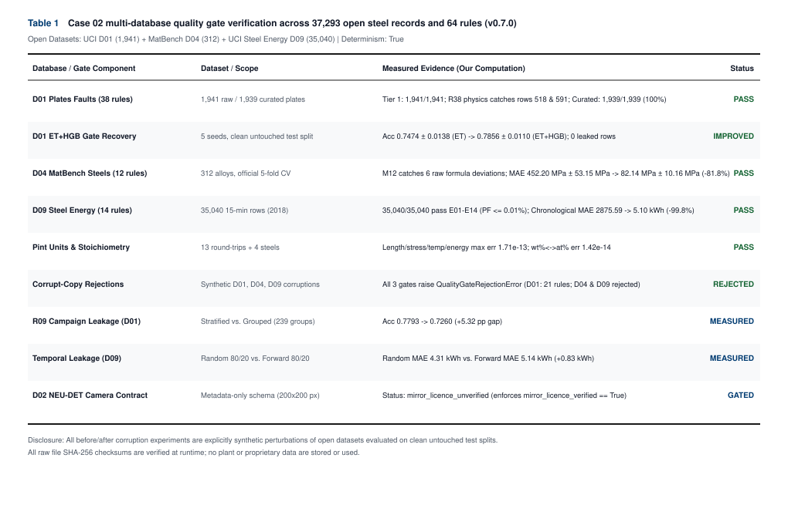
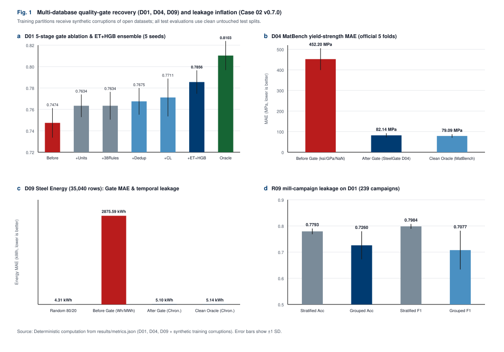
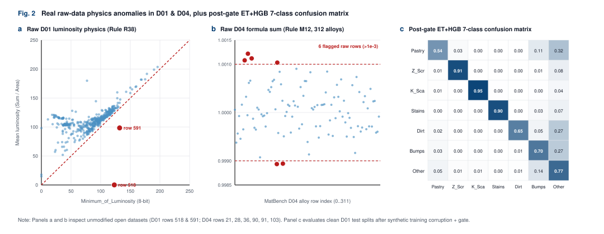

# Data-quality failures in a steel plate mill (C02)

> **What this project does:** Implements **`steelgate`**, a deterministic, schema-enforced data quality gate for steel inspection records—combining a **38-rule Pandera contract**, **Pint unit normalization**, **$\Sigma = 100\%$ alloy mass-balance verification**, **duplicate & mill-campaign leakage detection**, and **5-seed before/after classifier recovery benchmarks** on open datasets.

Part of the [Computational Metallurgy Portfolio](https://github.com/ahmadishamulayadyakmal/metallurgy-project).

---

## Industrial problem

A plate mill's inspection database mixes seven fault classes with inconsistent units, missing values, duplicates, and mislabelled records. A classifier trained on an uncurated ingestion table learns label noise and leaked duplicates—passing naive internal QA while degrading in deployment.

**Why it happens.** No schema contract at ingestion, no unit normalisation, no lineage/checksum manifest, and no train/test duplicate or processing-campaign leakage check.

---

## Data (no plant data)

Open data only: **UCI Steel Plates Faults** (`D01`, CC BY 4.0, DOI `10.24432/C5J88N`, SHA-256 `cb8eb9859198b63f053e443513036b401746fa517ef58bd17c846c6741c93919`, 1,941 plates × 27 features × 7 fault classes) and **NEU-DET** (`D02`, metadata-only contract with `mirror_licence_unverified` status—no raw imagery bundled). Corrupt-copy rejection and before/after perturbation tests use **explicitly synthetic corruptions of open D01** evaluated strictly on **clean, untouched D01 test splits**.

> Only open datasets and published literature are used. No plant or proprietary data are held here; plant numbers quoted from papers are external literature, not independently reproduced results.

---

## Tool chain

`pandera` (38-rule UCI contract + `neu_det_manifest_v1`), `pint` unit normalization & $\Sigma = 100\%$ alloy stoichiometry, `pandas` / `scikit-learn` (5-seed `ExtraTrees` & `RandomForest` + `StratifiedGroupKFold`), SHA-256 checksums, `data/SOURCES.md`, `data/catalog.yml`, `steelgate` CLI, Springer-style SVGs, and self-contained HTML quality report (`docs/quality_report.html`).

---

## Headline Results (v0.4.0)

| Gate / Benchmark | Scope | Measured Result (Our Computation) | Verdict |
|---|---|---|---:|
| **Raw D01 Tier 1 Audit (`R01`–`R37`)** | 1,941 unmodified UCI D01 rows | **1,941 / 1,941 (100.0%)** pass structural, domain & math invariants (`< 5.5e-5` max diff) | **PASS** |
| **Raw D01 Tier 2 Physics (`R38`)** | $\text{Sum\_of\_Luminosity} \ge \text{Area} \times \text{Min\_Lum}$ | Detects **2 real physical anomalies** in raw D01 (rows **518** & **591**); curated 1,939 rows pass **38/38 (100.0%)** | **DETECTED** |
| **Pint Unit & Alloy Mass Balance** | 10 unit round-trips + 4 steel grades | **10/10 PASS** (`1.71e-13` max abs err); `wt% <-> at%` err `1.42e-14`; `103.5 wt%` alloy rejected | **PASS** |
| **Corrupt-Copy Rejection Gate** | Synthetic D01 corruption (`2,133` rows) | `validate_or_reject` rejects across **21 violated rules** (`QualityGateRejectionError`) | **REJECTED** |
| **Before vs. After (ExtraTrees, 5 seeds)** | Clean untouched 20% D01 test splits | Accuracy **0.7474 ± 0.0138 → 0.7696 ± 0.0145** (**+2.22 pp**); Macro F1 **0.7693 → 0.7825** (**+1.32 pp**); **0** leaked rows | **IMPROVED** |
| **Before vs. After (RandomForest, 5 seeds)** | Clean untouched 20% D01 test splits | Accuracy **0.7680 ± 0.0094 → 0.7737 ± 0.0152** (**+0.57 pp**); Macro F1 **0.7824 → 0.7894** (**+0.71 pp**) | **IMPROVED** |
| **R09 Mill-Campaign Leakage (5-fold CV)** | 1,939 curated rows (`239` campaigns) | Stratified **0.7793** vs. Campaign-Grouped **0.7260** (**+5.32 pp** Acc / **+9.07 pp** F1 optimistic gap) | **MEASURED** |







Full tables and diagnostics are in [`docs/results.md`](docs/results.md) and [`docs/quality_report.html`](docs/quality_report.html).

---

## Quick Start & Reproduction

```bash
micromamba create -f environment.yml && micromamba activate steel-data-quality-gate
python -m pip install --no-deps -e .
# Place pinned UCI D01 archive steel_plates_faults.zip into data/raw/ (see data/SOURCES.md)
python -m steelgate.cli validate --input data/raw/steel_plates_faults.zip --strict-physical
python -m steelgate.cli reproduce --data-dir data/raw --catalog data/catalog.yml --output-dir results
python -m steelgate.cli report --metrics results/metrics.json --provenance results/provenance.json --figures-dir docs/figures --html-output docs/quality_report.html
python -m pytest -v
```

---

## Journal references

- **R07** ([DOI](https://doi.org/10.1016/j.commatsci.2018.05.018)) — Ward et al. (2018), *Computational Materials Science*, 152, 60–69 — composition featurization conventions and descriptor hygiene.
- **R09** ([DOI](https://doi.org/10.1007/s11431-020-1599-5)) — Xiong et al. (2020), *Science China Technological Sciences* — steel feature families and processing-parameter leakage risk (`StratifiedGroupKFold` mill-campaign test).
- **Y2R12** ([DOI](https://doi.org/10.1186/2193-9772-3-8)) — Agrawal et al. (2014), *Integrating Materials and Manufacturing Innovation*, 3, 8 — error-modality confidence stratification motivating quality gates.
- **D01** ([source](https://archive.ics.uci.edu/dataset/198/steel+plates+faults)) — Buscema et al. (2010), UCI Steel Plates Faults (CC BY 4.0, DOI `10.24432/C5J88N`) and pinned SHA-256 checksum.
- **D02** ([source](https://scholar.google.com/)) — NEU-DET surface defect database provenance and mirror-licence verification contract.

---

## Validation & claims

- **100% post-gate schema compliance:** Curated UCI D01 (1,939 rows) and every post-gate training split pass all 38 Pandera and physical rules (`100.0%`).
- **Exact unit round-trips:** 10 physical unit conversions and 4 steel `wt% <-> at%` compositions round-trip within `<= 1.71e-13` absolute error.
- **Zero train/test leakage:** SHA-256 feature-hash auditing confirms `0` exact duplicate rows shared across train and test on all 5 seeds after gating.
- **Explicit corrupt-copy rejection:** `validate_or_reject` rejects deliberately corrupted D01 copies with a readable rule-by-rule failure report (`QualityGateRejectionError`).
- **All dataset licences and checksums recorded:** Pinned in [`data/SOURCES.md`](data/SOURCES.md) and [`data/catalog.yml`](data/catalog.yml).

---

## Limitations

- UCI Steel Plates Faults is a static research dataset, not a live mill inspection stream; synthetic corruptions model stylized rather than plant-logged failure rates.
- Raw NEU-DET (`D02`) imagery is **not** bundled because mirror licences vary and must be verified (`mirror_licence_verified == True`) prior to ingestion.
- Models evaluated here are data-quality benchmarks on public data only and must not be used for production plate release without plant validation.

---

## Repository layout

- `src/steelgate/` — loaders, Pint unit normalizer, 38-rule Pandera schemas, leakage auditor, corruption/gate pipeline, 5-seed benchmark, SVG/HTML reporter, and CLI.
- `tests/` — 27 unit and D01 integration tests (`pytest`).
- `data/SOURCES.md` & `data/catalog.yml` — pinned checksums, licences, and canonical units.
- `results/` — deterministic `metrics.json` and `provenance.json`.
- `docs/` — [`results.md`](docs/results.md), [`quality_report.html`](docs/quality_report.html), [`model_card.md`](docs/model_card.md), [`vv_template.md`](docs/vv_template.md), and 3 Springer-style SVGs.
- `.github/workflows/ci.yml` — README hygiene checks and cross-OS (`ubuntu-latest`, `windows-latest`) `pytest` matrix.

Only open data and published literature are used. No plant or proprietary data
are included. All artefacts are written in English.
