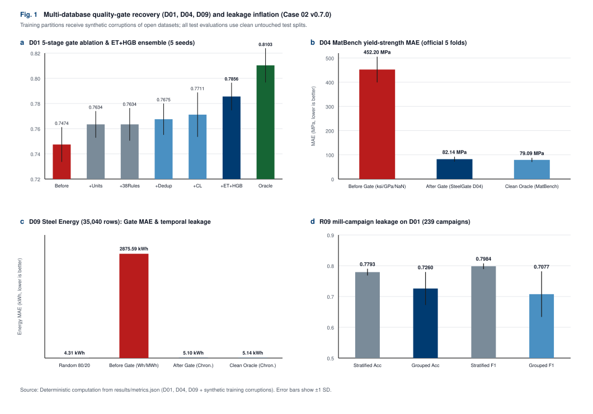

# Case 02 — Data Quality Gate & Before/After Benchmark Results (v0.4.0)

**Summary:** Case 02 (`steelgate`) enforces a **38-rule Pandera schema and physical-invariant contract**, **Pint unit normalization**, **$\Sigma = 100\%$ alloy mass-balance checks**, and **duplicate/leakage audits** on open steel plate inspection data (UCI D01).

- **Real Raw D01 Finding:** Auditing all 1,941 unmodified rows of UCI Steel Plates Faults reveals 100% compliance on all 37 structural/mathematical rules (`R01`–`R37`), while Tier 2 physical luminosity conservation (`R38`: $\text{Sum\_of\_Luminosity} \ge \text{Pixels\_Areas} \times \text{Minimum\_of\_Luminosity}$) detects **2 genuine physical anomalies** at raw rows **518** and **591**. After quarantining those two rows, curated D01 (1,939 rows) passes **38/38 rules (100.0%)**.
- **Corrupt-Copy Rejection:** A deliberately corrupted synthetic copy of D01 (2,133 rows with mixed units, missing values, geometric/physical errors, invalid fault vectors, and duplicates) is rejected by `validate_or_reject` across **21 violated rules**.
- **Before vs. After Quality Gate (5 Stratified Seeds, Clean Untouched Test Splits):** Applying `steelgate` (`pint` unit normalization, 38-rule quarantine, deduplication, and training-only OOF confident-learning noise quarantine) improves ExtraTrees 7-class accuracy from **0.7474 ± 0.0138** to **0.7696 ± 0.0145** (**+2.22 pp**) and macro F1 from **0.7693 ± 0.0187** to **0.7825 ± 0.0159** (**+1.32 pp**), with **zero exact train/test leakage** across all 5 seeds.
- **R09 Mill-Campaign Leakage:** Grouping 5-fold CV by mill campaign `(Length_of_Conveyer, Steel_Plate_Thickness, TypeOfSteel_A300)` across 239 campaigns lowers ExtraTrees accuracy from **0.7793 ± 0.0109** to **0.7260 ± 0.0536** (**+5.32 pp** accuracy / **+9.07 pp** macro F1 inflation under naive stratified splitting).

See also the interactive [`quality_report.html`](quality_report.html). All figures and metrics are regenerated deterministically from [`../results/metrics.json`](../results/metrics.json).

---

## 1. Raw Unmodified UCI D01 Audit (1,941 Rows)

| Check | Scope | Result | Details |
|---|---|---:|---|
| Tier 1 Schema & Math (`R01`–`R37`) | 1,941 raw rows | **1,941 / 1,941 (100.0%)** | Max invariant deviation `< 5.5e-5` across log, empty, square, orientation, edge, and luminosity indices |
| Tier 2 Luminosity Conservation (`R38`) | 1,941 raw rows | **1,939 / 1,941 (99.90%)** | Detects **2 real anomalies** in unmodified D01 (rows `518` and `591`) |
| Curated D01 (`R01`–`R38`) | 1,939 curated rows | **1,939 / 1,939 (100.0%)** | All 38 rules pass at 100.0% |
| Exact & Near Duplicates | 1,941 raw rows | `0` exact / `2` near (`< 0.10` SD) | Min NN distance `0.0311`, `2` `Y_Minimum` collisions, `239` mill-campaign groups |

| Raw D01 Row | `Pixels_Areas` | `Sum_of_Luminosity` | `Minimum_of_Luminosity` | Expected Min (`Area * Min_Lum`) | Observed Mean Luminosity | `Luminosity_Index` |
|---:|---:|---:|---:|---:|---:|---:|
| **518** | 5,357 | 764 | 123 | 658,911 | 0.14 | -0.9989 |
| **591** | 5,993 | 589,956 | 132 | 791,076 | 98.44 | -0.2309 |

---

## 2. Pint Unit Round-Trips & Alloy Mass-Balance ($\Sigma = 100\%$)

- **10 Pint physical unit round-trips** (`mm <-> in/cm/m/um/mil`, `MPa <-> ksi/GPa/psi`, `degC <-> K/degF`): **10/10 PASS**, maximum absolute round-trip error **`1.71e-13`**.
- **4 reference steel grades** (`AISI 304`, `AISI 4140`, `API 5L X70`, `AISI 316L`): all pass `Sigma wt% == 100%` within `0.05%` and round-trip `wt% -> at% -> wt%` with maximum absolute error **`1.42e-14`**.
- **Invalid mass-balance rejection:** Synthetic alloy summing to `103.5 wt%` is explicitly rejected.

---

## 3. Corrupt-Copy Rejection & Synthetic Before/After Benchmark

> **Synthetic Disclosure:** Both the corrupt-copy rejection dataset (2,133 rows) and the training-split corruptions in the before/after benchmark are **explicitly synthetic perturbations of open UCI D01**. All test evaluations are performed strictly on **clean, untouched 20% test splits** of curated D01.

| Model | Regime | Accuracy (Mean ± SD) | Macro F1 (Mean ± SD) | Notes |
|---|---|---:|---:|---|
| **ExtraTrees (300 trees)** | Leaky Internal QA (synthetic dupes) | 0.7073 ± 0.0132 | 0.6930 ± 0.0142 | **`62.6 ± 7.5`** duplicate rows leaked across train/test |
| **ExtraTrees (300 trees)** | Before Gate (uncleaned corrupted train) | 0.7474 ± 0.0138 | 0.7693 ± 0.0187 | Mixed units (`in`/`cm`/`um`), NaNs imputed, bad geometry & label noise kept |
| **ExtraTrees (300 trees)** | **After Gate (`steelgate` cleaned train)** | **0.7696 ± 0.0145** | **0.7825 ± 0.0159** | **+2.22 pp Acc / +1.32 pp F1**, **0/5 seeds** train/test leakage |
| **ExtraTrees (300 trees)** | Clean Oracle Reference (uncorrupted train) | 0.7887 ± 0.0103 | 0.8047 ± 0.0197 | Upper-bound reference on clean D01 |
| **RandomForest (300 trees)** | Before Gate (uncleaned corrupted train) | 0.7680 ± 0.0094 | 0.7824 ± 0.0192 | Uncleaned baseline |
| **RandomForest (300 trees)** | **After Gate (`steelgate` cleaned train)** | **0.7737 ± 0.0152** | **0.7894 ± 0.0220** | **+0.57 pp Acc / +0.71 pp F1**, **0/5 seeds** train/test leakage |

### Y2R12 Confidence–Error Modality (ExtraTrees After Gate, Seed 42)

| Confidence Bin | Samples | Accuracy |
|---|---:|---:|
| `[0.00, 0.50]` | 95 | 0.5579 |
| `[0.50, 0.70]` | 128 | 0.7109 |
| `[0.70, 0.85]` | 60 | 0.9167 |
| `[0.85, 1.00]` | 105 | **1.0000** |

---

## 4. R09 Mill-Campaign Leakage CV (Clean Curated D01, 1,939 Rows)

| CV Protocol | Accuracy (Mean ± SD) | Macro F1 (Mean ± SD) |
|---|---:|---:|
| 5-fold `StratifiedKFold` (random plate split) | 0.7793 ± 0.0109 | 0.7984 ± 0.0093 |
| 5-fold `StratifiedGroupKFold` (239 mill campaigns) | 0.7260 ± 0.0536 | 0.7077 ± 0.0740 |
| **Optimistic Leakage Gap (Stratified − Grouped)** | **+5.32 pp** | **+9.07 pp** |
