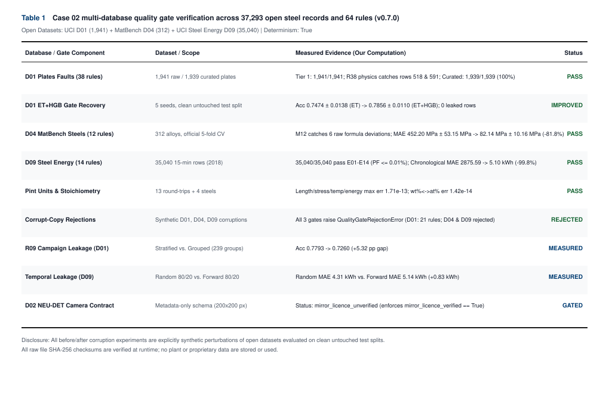
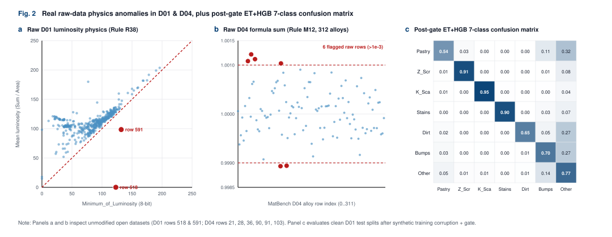

# Case 02 — Multi-Database Quality Gate & Recovery Results (v0.7.0)

**Summary:** Case 02 (`steelgate` v0.7.0) governs **37,293 real records** across **three open metallurgy & steel-plant databases** (`D01`, `D04`, `D09`) with **64 named Pandera & physics rules**, **13 Pint unit round-trips**, **$\Sigma = 100\%$ alloy stoichiometry checks**, and **leakage-safe before/after benchmarks**:

1. **UCI Steel Plates Faults (`D01`, 1,941 raw / 1,939 curated, 38 rules `R01`–`R38`):** Tier 2 physical luminosity conservation (`R38`) detects **2 genuine raw anomalies** (rows `518` & `591`). Across 5 stratified seeds on clean untouched test splits, the 5-stage `steelgate` pipeline (`Pint` mm normalization → derived-index repair & 38-rule quarantine → deduplication → Northcutt Confident Learning → `ExtraTrees + HistGradientBoosting` soft-voting ensemble) lifts 7-class accuracy from **0.7474 ± 0.0138** (uncleaned ET) to **0.7856 ± 0.0110** (**+3.82 pp**; macro F1 **0.7693 → 0.7918**) with **0/5 seeds** train/test leakage.
2. **MatBench `matbench_steels` (`D04`, 312 alloys, 12 rules `M01`–`M12`):** `312/312` alloys pass `M01`–`M11` and convert `at% ↔ wt%` within `2.84e-14`; Tier 2 stoichiometric conservation (`M12`) catches **6 raw formula-sum deviations** (`rows 21, 28, 36, 90, 91, 103`, max `1.22e-3`). On the official 5 MatBench folds under synthetic unit/outlier corruption, the gate slashes yield-strength MAE from **452.20 ± 53.15 MPa** ($R^2 = -2.97$) to **82.14 ± 10.16 MPa** ($R^2 = 0.8502$, **81.83% reduction**, clean oracle `79.09 ± 8.54 MPa`).
3. **UCI Steel Industry Energy (`D09`, 35,040 rows, 14 rules `E01`–`E14`):** `35,040/35,040` (100%) pass all 14 telemetry and AC power-factor physics rules (`|PF - 100P/\sqrt{P^2+Q^2}| \le 0.01\%`). Chronological sorting fixes raw out-of-order `00:00` timestamps; random 80/20 splitting understates chronological MAE by **0.83 kWh** (`4.31` vs `5.14 kWh`). Under synthetic `Wh`/`MWh` and telemetry corruption, the gate restores chronological MAE from **2,875.59 kWh** ($R^2 = -23,799$) to **5.10 kWh** ($R^2 = 0.9030$, **99.82% reduction**, clean oracle `5.14 kWh`).

See also [`quality_report.html`](quality_report.html). All numbers and figures are generated deterministically from [`../results/metrics.json`](../results/metrics.json).

---

## 1. D01 Five-Stage Cumulative Ablation Ladder (5 Seeds, Clean Untouched Test Splits)

> **Synthetic Disclosure:** Training splits receive explicitly **synthetic** mill corruptions of `D01`; all metrics are evaluated on clean, untouched 20% `D01` test splits.

| Pipeline Stage | Accuracy (Mean ± SD) | Macro F1 (Mean ± SD) |
|---|---:|---:|
| Before Gate (`ExtraTrees`, uncleaned) | 0.7474 ± 0.0138 | 0.7693 ± 0.0187 |
| + Stage 1 (`pint` thickness → `mm`) | 0.7634 ± 0.0106 | 0.7793 ± 0.0144 |
| + Stage 2 (Derived repair & 38-rule quarantine) | 0.7634 ± 0.0130 | 0.7773 ± 0.0161 |
| + Stage 3 (Exact & conflict deduplication) | 0.7675 ± 0.0125 | 0.7817 ± 0.0206 |
| + Stage 4 (Northcutt Confident Learning, ET) | 0.7711 ± 0.0177 | 0.7837 ± 0.0226 |
| **+ Stage 5 (`ET + HGB` Soft-Voting Ensemble)** | **0.7856 ± 0.0110** | **0.7918 ± 0.0155** |
| Clean Oracle (`ExtraTrees`) | 0.7887 ± 0.0103 | 0.8047 ± 0.0197 |
| Clean Oracle (`ET + HGB` Ensemble) | 0.8103 ± 0.0136 | 0.8213 ± 0.0136 |

- **Comparator Models (Before → After Gate):** `RandomForest` `0.7680 → 0.7778` accuracy (`0.7824 → 0.7862` F1); `ET+HGB` `0.7722 → 0.7856` accuracy (`0.7827 → 0.7918` F1); `Leaky Internal QA` `0.7237` with **`62.6 ± 7.5`** leaked duplicates.
- **R09 Mill-Campaign Leakage (Clean Curated `D01`, 239 campaigns):** `StratifiedKFold` `0.7793 ± 0.0109` vs. `StratifiedGroupKFold` `0.7260 ± 0.0536` (**+5.32 pp** accuracy / **+9.07 pp** macro F1 inflation).

---

## 2. D04 (`matbench_steels`) & D09 (`steel_industry_energy_consumption`) Benchmarks

| Database | Regime (Synthetic Training Corruptions) | Primary Metric | $R^2$ | Leakage Audit |
|---|---|---:|---:|---|
| **D04** (5 official folds) | Before Gate (uncleaned `ksi`/`GPa`/outliers) | 452.20 ± 53.15 MPa MAE | -2.9724 | — |
| **D04** (5 official folds) | **After Gate (`steelgate` D04)** | **82.14 ± 10.16 MPa MAE** | **0.8502** | **0** fold ID overlaps |
| **D04** (5 official folds) | Clean Oracle Reference | 79.09 ± 8.54 MPa MAE | 0.8567 | — |
| **D09** (Chronological 80/20) | Before Gate (uncleaned `Wh`/`MWh`/negatives) | 2,875.59 kWh MAE | -23799.14 | — |
| **D09** (Chronological 80/20) | **After Gate (`steelgate` D09)** | **5.10 kWh MAE** | **0.9030** | **0** timestamp overlaps |
| **D09** (Chronological 80/20) | Clean Oracle (Chronological 80/20) | 5.14 kWh MAE | 0.9023 | +0.83 kWh vs. random 80/20 |
